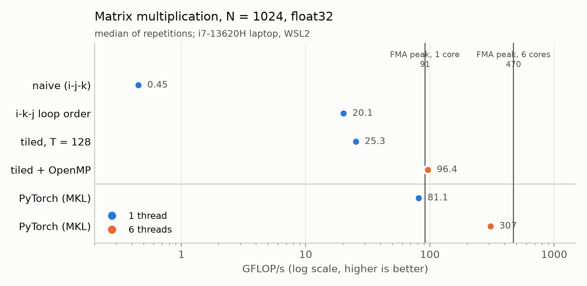
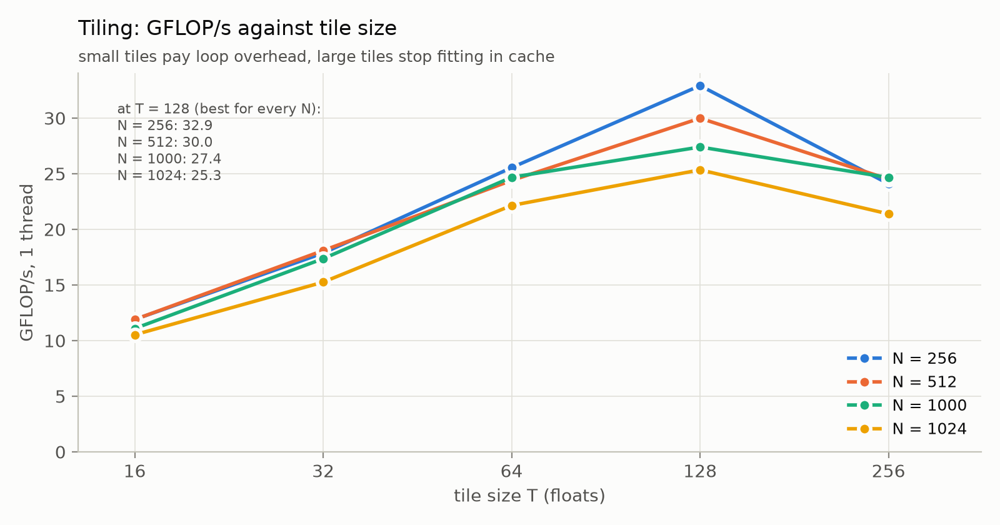
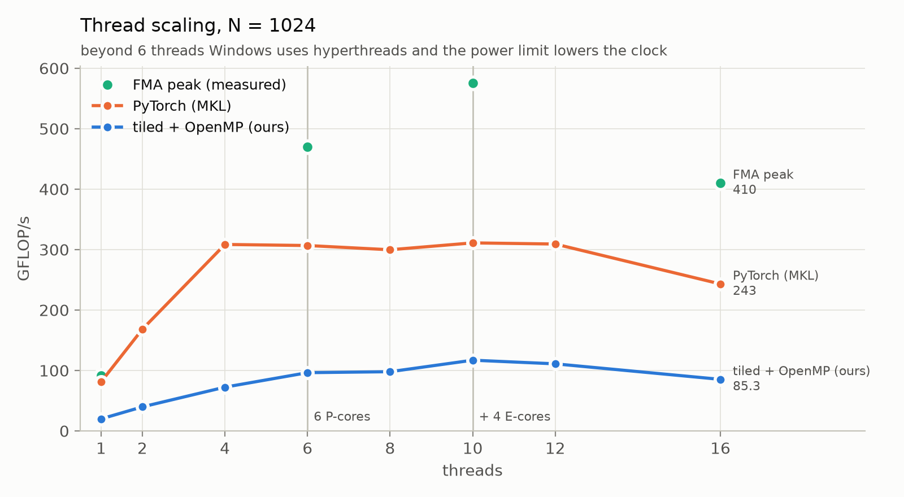
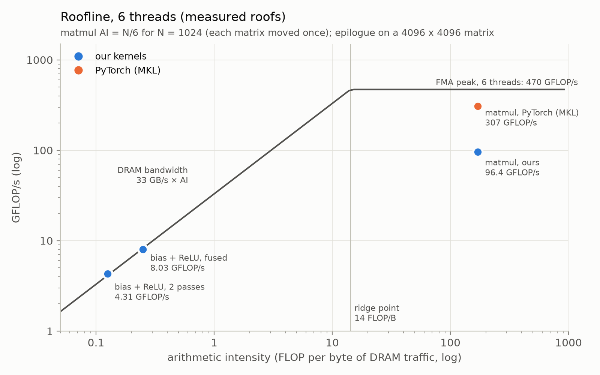

# matmul-bench

Step-by-step optimization of single-precision matrix multiplication (`C = A·B`, square,
row-major float32) on a laptop CPU. Every step is **measured** (fixed seed, repetitions,
median and coefficient of variation), **tested** against a reference within a rounding-error
bound, and **explained** with a model of the memory hierarchy, before being compared with
PyTorch (Intel MKL) on the same machine.

The point is not to beat BLAS. The point is to understand where each factor of speed comes
from, and to say in numbers why the remaining gap exists. Hypotheses, models, every measurement
and the open questions for each stage are in [docs/NOTES.md](docs/NOTES.md) (in Polish).

## Results



GFLOP/s = 2N³ / time, median of 5 repetitions:

| Version | Threads | N=256 | N=512 | N=1000 | N=1024 | % of measured FMA peak (N=1024) |
|---|---|---|---|---|---|---|
| naive (i-j-k) | 1 | 2.56 | 2.01 | 2.58 | 0.45 | 0.5% |
| i-k-j | 1 | 24.9 | 26.2 | 19.6 | 20.1 | 22% |
| tiled, T=128 | 1 | 32.9 | 30.0 | 27.4 | 25.3 | 28% |
| tiled + OpenMP | 6 | 73.6 | 85.1 | 92.5 | 96.4 | 20% |
| PyTorch (MKL) | 1 | 83.4 | 83.4 | 82.3 | 81.1 | 89% |
| PyTorch (MKL) | 6 | 217 | 281 | 319 | 307 | 65% |

Measured roofs on this machine: FMA peak **91 GFLOP/s on one core, 470 on six**; DRAM bandwidth
**33 GB/s** with 6 threads (one thread gets ~11–14 GB/s).

- **Loop order alone gives 8–13×** (45× at N = 1024, where naive is pathological: a row of B is
  exactly 4 KiB, so walking down a column keeps hitting the same cache sets). The inner loop
  becomes a contiguous `C[i,:] += a·B[k,:]` that GCC vectorizes with AVX2 FMA.
- **Tiling adds 15–40%**, but stops at ~28% of the core's peak. The inner loop still issues
  2 loads and 1 store per FMA, and short loops pay a start-up cost (measured model: ~5 cycles per
  inner-loop start plus ~1.1 cycles per 8 floats).
- **6 threads: 3.8× over the best single-threaded version.** Beyond 6 threads the OS puts the
  extra threads on hyperthreads (which share a core's load/store ports) and the power limit lowers
  the clock for everyone.
- **MKL is 3.2× faster than our code with 1 thread and with 6.** The gap is the structure of the
  kernel (register blocking, packing; see below), not more parallelism.
- **Fusing bias + ReLU into the matmul gives no measurable speedup here.** The epilogue is 0.3%
  of the run time. Fusing the two elementwise passes with each other, on the other hand, halves
  their memory traffic and gives ~2×.

## The steps

| # | Version | Idea | Source |
|---|---|---|---|
| 1 | naive i-j-k | textbook loop; B is read down a column (stride N) | [src/naive.cpp](src/naive.cpp) |
| 2 | i-k-j | swap two loops: the inner loop becomes a contiguous `C[i,:] += a·B[k,:]` that vectorizes (AVX2 FMA) | [src/ikj.cpp](src/ikj.cpp) |
| 3 | tiled | block formula `C_IJ = Σ_K A_IK·B_KJ` with T×T tiles: B traffic from L3 drops from N³ to N³/T floats | [src/tiled.cpp](src/tiled.cpp) |
| 4 | tiled + OpenMP | one C tile per task (`collapse(2)`, dynamic schedule); no shared writes, bit-identical for any thread count | [src/tiled_omp.cpp](src/tiled_omp.cpp) |
| 5 | fused linear + ReLU | `relu(A·B + bias)` with bias and ReLU applied to each C tile while it is in cache, against three separate passes | [src/linear_relu.cpp](src/linear_relu.cpp) |

### Tiling: a measurable trade-off



Larger tiles reload B from L3 less often (B traffic is N³/T floats), but tiles that are too large
stop fitting in L1/L2. Small tiles also run short inner loops whose start-up cost dominates.
T = 128 (a 64 KiB tile of C) is the best size for every N.
Variants whose inner loop is 256 floats long varied between sessions by up to 1.5×; that one is
listed as an open question in the notes.

### Threads: the clock is not constant



| Threads | 1 | 2 | 4 | 6 | 8 | 10 | 12 | 16 |
|---|---|---|---|---|---|---|---|---|
| tiled + OpenMP (CV) | 19.9 (3%) | 39.8 (2%) | 72.4 (17%) | 96.4 (2%) | 98.0 (17%) | 117 (29%) | 111 (29%) | 85.3 (11%) |
| PyTorch / MKL (CV) | 81.1 (6%) | 168 (1%) | 308 (3%) | 307 (3%) | 300 (14%) | 311 (6%) | 309 (4%) | 243 (49%) |
| FMA peak | 91.3 | | | 470 | | 576 | | 410 |

- Each thread computes whole tiles of C, so there are no locks, no atomics and no shared writes,
  and every element is summed in the same order: the result is identical bit for bit for any thread
  count.
- **2 threads give 2.0×.** After that the speedup flattens. Windows performance counters, read
  during a diagnostic run (stage 4 notes), showed that 6 threads land one per P-core at ~3.1 GHz, threads 7–16 go mostly to hyperthread siblings, and the clock
  drops to ~2.0 GHz at 16 threads (power limit). Even the pure-FMA benchmark is slower at 16
  threads than at 10.
- MKL stops scaling at 4 threads (~310 GFLOP/s, 65% of the 6-thread FMA peak). N = 1024 is a
  7 ms problem at that speed; the power budget and per-thread overheads are likely causes, but
  this was not diagnosed (no hardware counters under WSL2).
- With a fixed amount of work per thread, the FMA benchmark reached only 299 GFLOP/s on 6 threads
  instead of ~490: the slowest core (an E-core or a hyperthread sibling) sets the pace. Dynamic
  scheduling fixes that.
- The OpenMP version on one thread is slower than the serial tiled kernel (19.9 vs 25.3) despite an
  identical inner loop. A measurement in stage 5 showed that two compiled copies of the same loop
  can differ by 3–8%, which is the likely cause; not confirmed.

### Fusion: when it pays off

Unfused `relu(A·B + bias)` makes three passes over C (matmul, bias, ReLU); the fused version
applies bias and ReLU to each C tile right after its last k block, while it is still in cache.

| Case | Threads | Separate passes | Fused | Ratio |
|---|---|---|---|---|
| relu(A·B + bias), N=1024, final run | 1 | 93.0 ms (CV 9%) | 88.1 ms (CV 4%) | 1.06, within noise |
| | 6 | 17.9 ms (CV 17%) | 17.0 ms (CV 19%) | 1.05, within noise |
| same, dedicated run with 15 repetitions | 1 | 88.1 ms (CV 3%) | 88.9 ms (CV 3%) | 0.99 |
| | 6 | 17.8 ms (CV 5%) | 18.4 ms (CV 17%) | 0.97 |
| bias + ReLU alone, 4096² floats in DRAM | 1 | 17.0 ms | 8.3 ms | **2.05** |
| | 6 | 7.8 ms | 4.2 ms | **1.86** |

The cost of two extra passes relative to the matmul is

```
(16·N² bytes / BW) / (2·N³ FLOP / F) = 8·F / (K·BW)        (K = the summed dimension, here N)
```

This gives 0.3–0.4% here, which matches the measured epilogue time and is far below the noise.
The ratio grows with a faster GEMM (F) and a smaller K: for a BLAS-class kernel writing C to DRAM
it is ~11% at K = 1024, and on accelerators, whose compute-to-bandwidth ratio is an order of
magnitude higher, it exceeds the matmul itself. PyTorch's own trace shows what eager mode does for
`nn.Linear` + ReLU: `aten::addmm` (the bias is copied into C and BLAS accumulates onto it), then a
separate `aten::relu`. Its cost was not visible either: 26.47 ms against 26.47 ms for the bare
matmul on one thread.

## Roofline



`attainable GFLOP/s = min(compute peak, arithmetic intensity × bandwidth)`, with both roofs
measured on this machine. The ridge point is at 470 / 33 ≈ 14 FLOP/B.

- **The elementwise kernels sit on the memory roof** (AI = 0.125 FLOP/B for two passes, 0.25 when
  fused). They cannot compute faster, only move fewer bytes. Fusion moves the point to the right
  and doubles the attainable rate, and the measurement follows the roof.
- **Matrix multiplication is far to the right of the ridge point** (AI ≈ N/6 ≈ 170 FLOP/B when
  every matrix crosses DRAM once), so bandwidth limits neither implementation. Ours stays at 20%
  of the compute roof (28% on one core) because of its instruction mix, and MKL reaches 65% (89% on
  one core). The roofline shows that the gap is inside the core, not in memory.

## What BLAS does that this code does not

MKL reaches 81 GFLOP/s on one core (89% of the measured FMA peak), where our best
single-threaded kernel reaches 25. High-performance GEMMs share a structure (Goto & van de Geijn,
*Anatomy of High-Performance Matrix Multiplication*, 2008; the BLIS framework), and each part
targets a limit that showed up in the measurements above:

1. **Register blocking (micro-kernel).** A small block of C, for example 6×16 floats in 12 AVX2
   registers, stays in registers for the whole k loop. Each step loads 2 vectors of B and
   broadcasts 6 elements of A for 12 FMAs, which is 0.67 loads per FMA and no stores. Our inner loop
   needs 2 loads and 1 store per FMA. The 12 independent accumulators also hide the 4-cycle FMA
   latency on two FMA units, the same reason the peak benchmark uses 12 chains.
2. **Packing.** Panels of A and B are copied into contiguous, aligned buffers in exactly the order
   the micro-kernel reads them. This gives unit stride and no TLB misses, and it removes the cache-set
   conflicts that make our naive kernel 5× slower at N = 1024 than at N = 1000.
3. **Cache blocking on three levels.** A sliver of B stays in L1, a block of A in L2 and a panel
   of B in L3, with sizes derived from the cache parameters instead of one tile size for all.
4. **Parallelism on the right loop.** Threads share a packed panel of B in L3. On top of that come
   prefetching, edge-case kernels and dispatch per microarchitecture (MKL selects its AVX2 path on
   this CPU).

On accuracy, MKL's results stay within the same error bound as ours. The largest
`|C − exact| / Σ|a·b|` is 0.8–2.6·10⁻⁷, against a bound of N·ε = 3·10⁻⁵ at N = 256.

## The same ideas on a spatial accelerator (Tenstorrent Tensix)

A Tensix core has no cache hierarchy that decides what stays close to the compute units.
It has local SRAM (about 1–1.5 MB per core, depending on the chip generation), five small
RISC-V cores (two move data over the network-on-chip, three drive an unpack → math → pack
pipeline), a matrix engine (FPU) that works on 32×32 tiles, and a vector engine (SFPU).
A typical TT-Metalium program is three kernels per core (reader, compute, writer) connected
by circular buffers in SRAM. Each idea from this project has a direct counterpart:

| This project (CPU) | Tensix |
|---|---|
| Tiling for cache: pick T so that the working set *probably* stays in L2 | Tiles are the hardware unit (32×32); the reader kernel *explicitly* copies blocks into SRAM, so reuse is planned rather than hoped for |
| Register blocking in BLAS: a C block accumulates in vector registers | The math engine accumulates tile results in the Dst registers, fed through SrcA/SrcB by the unpacker |
| OpenMP: one C tile per thread, no shared writes | The output is partitioned across the grid of cores; input blocks are moved or multicast over the NoC |
| Fusion: bias + ReLU applied to the tile while it is in cache | The SFPU applies the activation to the tile in Dst before it is packed out: fusion is the normal dataflow |
| Roofline: ridge point ≈ 14 FLOP/B here, so an unfused epilogue costs 0.3% | A much higher compute-to-bandwidth ratio: by the same formula, 8·F/(K·BW), an unfused pass through DRAM would cost about as much as the matmul, so intermediates stay in SRAM |
| Cache-set conflicts at a 4 KiB stride that the code cannot control | No caches, so no conflict misses; in exchange, data movement is written by hand and overlapped with compute (e.g. double-buffered circular buffers) |

Sources: TT-Metalium documentation,
[compute engines and data flow within Tensix](https://docs.tenstorrent.com/tt-metal/latest/tt-metalium/tt_metal/advanced_topics/compute_engines_and_dataflow_within_tensix.html),
[tiles](https://docs.tenstorrent.com/tt-metal/latest/tt-metalium/tt_metal/advanced_topics/tiles.html),
[single-core matmul example](https://docs.tenstorrent.com/tt-metal/latest/tt-metalium/tt_metal/examples/matmul_single_core.html),
[Metalium guide](https://github.com/tenstorrent/tt-metal/blob/main/METALIUM_GUIDE.md).

## Methodology

- **Build:** Release, `-O3 -march=native`, no `-ffast-math` (the compiler may not reorder float
  sums). GCC contracts `a*b + c` into FMA, which is why i-k-j differs from naive in the last bit
  for part of the elements (one rounding instead of two).
- **Correctness:** every version is checked against a double-precision reference and against
  the naive kernel with a relative bound `|C − C_ref| ≤ N·ε·Σ|a·b|` (the classic dot-product
  error bound), on odd sizes, edge tiles and odd thread counts. Versions that do not reorder the
  sum (tiled, OpenMP, fused) are additionally required to match i-k-j **bit for bit**.
  157 tests ([tests/test_matmul.cpp](tests/test_matmul.cpp)).
- **Timing:** [Google Benchmark](https://github.com/google/benchmark), wall-clock time
  (`UseRealTime`; its default CPU time only covers the main thread), ≥ 5 repetitions with
  random interleaving of all benchmarks, median reported, CV < 5% treated as trustworthy.
  The clock is probed before and after each series with a dependent-add chain
  ([tools/clock_probe.cpp](tools/clock_probe.cpp)).
- **Roofs are measured, not taken from the datasheet:** compute roof with 12 independent FMA
  chains per thread ([bench/bench_peak.cpp](bench/bench_peak.cpp)), memory roof with a
  multithreaded saxpy on 128 MiB ([bench/bench_bandwidth.cpp](bench/bench_bandwidth.cpp)).
- **Machine and caveats:** Intel Core i7-13620H (6 P-cores with HT + 4 E-cores, AVX2, L2
  1.25 MiB per P-core, L3 24 MiB), 2×32 GB DDR4-3200, Windows 11 + WSL2 (Ubuntu 24.04, GCC 13).
  Final series: Windows "Balanced" power mode, AC power with the battery charging, turbo on
  (it cannot be switched off from WSL2), single-core clock 2.6–2.9 GHz before and after the series
  ([results/final_clock.txt](results/final_clock.txt)), PyTorch 2.15 (CPU build, MKL 2024.2).
  Absolute numbers depend on the power mode; the comparisons were made within one series.
  WSL2 hides the real core topology (no pinning to P- or E-cores, no hardware counters), which
  limits how far some effects could be diagnosed; open questions are listed in the notes.

## Build and run

```bash
# C++ (Linux or WSL2; CMake >= 3.24, GCC/Clang with OpenMP)
cmake -S . -B build -G Ninja -DCMAKE_BUILD_TYPE=Release
cmake --build build
ctest --test-dir build -j4 --output-on-failure
./build/clock_probe                                   # current core clock

# one benchmark group, e.g. the tile sweep (JSON goes to results/)
bash scripts/run_bench.sh my_run 'BM_Tiled' 5

# full series behind this README (~10 min), then plots and tables
python3 -m venv ~/.venvs/matmul-bench && . ~/.venvs/matmul-bench/bin/activate
pip install -r scripts/requirements.txt --extra-index-url https://download.pytorch.org/whl/cpu
bash scripts/run_final.sh 5
python scripts/plot_results.py
```

## Repository layout

```
include/matmul/   kernel API (raw pointers, BLAS-style) and an aligned Matrix helper
src/              one file per version
tests/            GoogleTest: rounding-error bounds, bit-identity, edge cases
bench/            Google Benchmark: kernels, fusion, memory bandwidth, FMA peak
tools/            clock_probe (core clock and FP latencies)
scripts/          run_bench.sh, run_final.sh, bench_torch.py, plot_results.py
results/          final_cpp.json, final_torch.json, final_clock.txt
docs/NOTES.md     detailed notes per stage: models, hypotheses, measurements (in Polish)
docs/img/         charts
```
